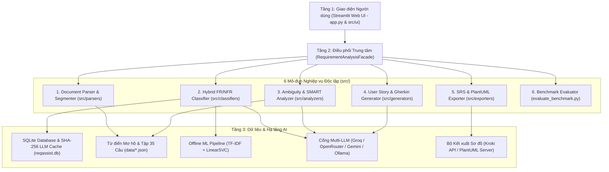

# Kiến trúc & Đặc tả Hệ thống — BA-Gen (ReqAssist-NLP)

Tài liệu này mô tả thiết kế kiến trúc, lựa chọn công nghệ thực tế, chiến lược vận hành LLM tiết kiệm hạn mức và bộ đặc tả yêu cầu hoàn chỉnh cho hệ thống **BA-Gen (ReqAssist-NLP)**.

---

## 1. Tổng quan & Mục tiêu Dự án

### 1.1 Bài toán thực tế
Trong quy trình Kỹ thuật Yêu cầu (*Requirements Engineering*), tài liệu mô tả bài toán từ khách hàng thường tồn tại ở dạng văn bản tự nhiên phi cấu trúc (`.txt`, `.docx` hoặc đoạn văn bản thô) bằng tiếng Việt hoặc tiếng Anh. Chuyên viên Phân tích Nghiệp vụ (BA) phải đọc thủ công để tách câu, phân loại Yêu cầu Chức năng (`FR`) / Phi chức năng (`NFR`), rà soát từ ngữ cảm tính mơ hồ, chuyển thành Agile User Stories và vẽ sơ đồ Use Case.

### 1.2 Phạm vi & 6 Chức năng Cốt lõi (F1–F6)
Hệ thống hỗ trợ song ngữ **Tiếng Việt (`vi`)** và **Tiếng Anh (`en`)**, gồm 6 nhóm chức năng:
- **F1 — Đọc tài liệu đa định dạng & tách câu nguyên tử:** Tiếp nhận văn bản dán trực tiếp, `.txt`, `.docx` (bao gồm cả đoạn văn và bảng biểu, giới hạn `<= 25 MB`), chuẩn hóa Unicode `NFC` và tách thành từng câu yêu cầu đơn lẻ.
- **F2 — Phân loại FR / NFR lai ghép:** Phân loại từng câu thành `FR` hoặc `NFR` kèm nhãn phụ chuẩn ISO/IEC 25010 (*Performance, Security, Usability, Reliability, Maintainability, Portability*) và điểm độ tin cậy (`0–100%`).
- **F3 — Phát hiện từ mơ hồ, thiếu tác nhân/số liệu & gợi ý chuẩn SMART:** Quét từ điển 120+ từ cảm tính song ngữ, phát hiện câu bị động thiếu Actor và câu NFR thiếu số liệu định lượng, đồng thời đề xuất câu viết lại chuẩn SMART.
- **F4 — Sinh Agile User Stories & Tiêu chí Nghiệm thu Gherkin:** Chuyển đổi mỗi yêu cầu thành cấu trúc `Role - Goal - Benefit` kèm tối thiểu 2 kịch bản `GIVEN / WHEN / THEN`.
- **F5 — Xuất bản SRS rút gọn & Sơ đồ Use Case PlantUML:** Xuất tệp `.docx` / `.md` tuân thủ chuẩn IEEE 830 / ISO 29148 và sinh mã `@startuml ... @enduml` kết xuất ảnh `.png` / `.svg`.
- **F6 — Đánh giá Kiểm chuẩn (Benchmark Evaluator):** Đo lường Accuracy, Precision, Recall, Macro F1-Score và Ma trận Nhầm lẫn 2×2 trên bộ 35 câu yêu cầu gán nhãn thủ công.

---

## 2. Kiến trúc Tổng thể (3-Tier Modular Monolith)

Hệ thống áp dụng kiến trúc **Modular Monolith phân tách 3 tầng** nhằm loại bỏ độ trễ giao tiếp mạng giữa các mô-đun nhỏ, dễ dàng đóng gói trong một ứng dụng Python/Docker duy nhất nhưng vẫn đảm bảo tách biệt ranh giới trách nhiệm thông qua các giao diện trừu tượng.



---

## 3. Lựa chọn Công nghệ Thực tế (Real-World Stack)

Để dự án cài đặt mượt mà trên Windows/Linux/macOS mà không vướng lỗi biên dịch C++ hoặc cấu hình Java/Graphviz cục bộ, bộ công nghệ được chuẩn hóa như sau:

| Thành phần | Công nghệ Thực tế Lựa chọn | Lý do Thực tế & Tối ưu Triển khai |
| :--- | :--- | :--- |
| **Giao diện Web** | `Streamlit` + CSS tùy chỉnh | Xây dựng nhanh bàn làm việc tương tác (tải tệp, bảng dữ liệu màu sắc, thẻ User Story, nút tải xuống) chỉ với Python thuần. |
| **Kiểm soát Dữ liệu** | `Pydantic v2` | Ép kiểu chặt chẽ cho DTO nội bộ và kiểm soát định dạng JSON trả về từ LLM. |
| **Đọc & Tách câu Song ngữ** | `python-docx` + Regex chuẩn Unicode `NFC` | Thay thế `spaCy`/`Underthesea` nặng nề (dễ lỗi C++ Build Tools trên Windows) bằng bộ Regex thông minh xử lý dấu viết tắt (`VD.`, `TP.`, `e.g.`) và số thập phân (`99.9%`). |
| **Học máy Ngoại tuyến** | `scikit-learn` (`TfidfVectorizer` + `LinearSVC`) | Nhẹ, chạy trong vài chục mili-giây trên CPU mà không cần GPU; đóng vai trò lớp dự phòng ngoại tuyến tức thời. |
| **Cổng LLM Đa nhà cung cấp** | `openai` Python SDK (chuẩn OpenAI-compatible) | Dùng **1 SDK duy nhất** để chuyển đổi linh hoạt giữa **Groq** (tốc độ cao, free tier rộng), **OpenRouter** (nhiều model `:free`), **Gemini** và **Ollama** (local) chỉ bằng thay đổi `base_url`, `api_key`, `model`. |
| **Xuất SRS Word** | `python-docx` | Tạo tệp OpenXML `.docx` chuẩn bảng biểu, phông Unicode tiếng Việt, mở chuẩn trên MS Word, Google Docs và LibreOffice. |
| **Kết xuất Sơ đồ Use Case** | `Kroki API` / PlantUML Web Server + xuất `.puml` | Chuyển mã `@startuml ... @enduml` thành ảnh `.png`/`.svg` qua HTTPS mà **không yêu cầu cài Java Runtime và Graphviz** trên máy người dùng. |
| **Lưu trữ & Bộ nhớ đệm** | `SQLite 3` (`sqlite3` stdlib) | Lưu lịch sử phân tích và bảng đệm `llm_cache` ngay trong một tệp cục bộ duy nhất. |

---

## 4. Chiến lược Tối ưu Quota AI & Chịu lỗi (Zero-Training, Batching, Caching, Fallback)

### 4.1 Tiếp cận Không Huấn luyện (Zero-Training / In-Context Learning)
Hệ thống **không cần tự huấn luyện hay fine-tune mô hình Deep Learning**. Đối với các tác vụ hiểu ngữ nghĩa sâu (phân loại câu biên khó, viết lại câu SMART, bóc tách User Story + Gherkin), hệ thống tận dụng các mô hình nền tảng thông qua kỹ thuật **Few-Shot Prompting** kết hợp **Structured JSON Output**. Mô hình `LinearSVC` chỉ fit nhanh trên tập mẫu nhỏ ở CPU trong chưa tới `0.1 giây` để phục vụ chế độ ngoại tuyến.

### 4.2 Gom nhóm truy vấn (Batch Prompting)
Thay vì gọi API riêng lẻ cho từng câu (dễ gặp lỗi giới hạn tốc độ `HTTP 429`), hệ thống gom **10–15 câu vào một mảng JSON** và gửi trong **1 lượt gọi API duy nhất**. Với tài liệu kiểm chuẩn 35 câu, toàn bộ quy trình phân loại chỉ tiêu tốn **2–3 lượt gọi API**.

### 4.3 Bộ nhớ đệm SQLite (`SHA-256 Cache`)
Mỗi câu yêu cầu kèm tên nhà cung cấp/mô hình được băm `SHA-256`. Nếu kết quả đã tồn tại trong bảng `llm_cache`, hệ thống đọc thẳng từ SQLite trong `<= 0.01 giây` với **0 lượt gọi API**.

### 4.4 Cơ chế Tự chuyển đổi Dự phòng (Circuit-Breaker Fallback)
Khi cổng LLM gặp một trong các sự cố: mất mạng, hết hạn mức (`HTTP 429`), lỗi máy chủ (`500`/`503`), khóa API không hợp lệ hoặc quá thời gian chờ (`timeout`), hệ thống thực hiện tối đa 2 lần thử lại rồi tự động chuyển mạch sang **`OfflineMLClassifierStrategy` (`TF-IDF + LinearSVC`)** kết hợp bộ quy tắc SMART/User Story ngoại tuyến trong vòng `<= 2.0 giây`, đảm bảo ứng dụng không bao giờ treo khi trình diễn.

---

## 5. Các Mẫu Thiết kế Hướng đối tượng (5 GoF Design Patterns)

| Mẫu Thiết kế | Tệp Triển khai Dự kiến | Vai trò & Giá trị Kỹ thuật |
| :--- | :--- | :--- |
| **Strategy Pattern** | `src/classifiers/base.py`, `ml_classifier.py`, `llm_classifier.py`, `hybrid_classifier.py` | Đóng gói các thuật toán phân loại dưới cùng giao diện `IClassifierStrategy`, cho phép chuyển nóng giữa Groq, OpenRouter, Gemini và Offline ML. |
| **Factory Method Pattern** | `src/parsers/factory.py` | Lớp `DocumentIngestionFactory` tự khởi tạo đúng bộ đọc (`RawTextParser`, `TxtDocumentParser`, `DocxDocumentParser`) theo định dạng đầu vào. |
| **Facade Pattern** | `src/core/facade.py` | Lớp `RequirementAnalysisFacade` cung cấp cổng gọi thống nhất cho giao diện Streamlit, che giấu toàn bộ đường ống 6 bước phía sau. |
| **Builder Pattern** | `src/exporters/srs_builder.py` | Lớp `SRSBuilder` lắp ghép tuần tự 6 chương mục của bản SRS rút gọn trước khi kết xuất sang `.docx` hoặc `.md`. |
| **Singleton Pattern** | `src/utils/lexicon.py` | Lớp `NLPLexiconManager` đảm bảo từ điển `ambiguity_lexicon.json` chỉ nạp vào bộ nhớ RAM đúng một lần trong suốt vòng đời ứng dụng. |

---

## 6. Đặc tả Yêu cầu Hệ thống

### 6.1 Yêu cầu Chức năng (Functional Requirements)

| Nhóm Tính năng | Mã YC | Nội dung Đặc tả |
| :--- | :--- | :--- |
| **F1 — Đọc & Tách câu** | `REQ-1.1` | Hỗ trợ 3 kênh đầu vào: dán văn bản trực tiếp, tệp `.txt`, tệp `.docx` (`<= 25 MB`). |
| | `REQ-1.2` | Giải mã UTF-8/UTF-16 và chuẩn hóa Unicode dựng sẵn (`NFC`) để bảo toàn dấu tiếng Việt. |
| | `REQ-1.3` | Đọc đồng thời `paragraphs` và `tables` trong `.docx` ở chế độ chỉ đọc; cắt bỏ ký hiệu đầu dòng. |
| | `REQ-1.4` | Tự động nhận diện ngôn ngữ (`vi`/`en`) và tách thành các câu ứng viên tối thiểu `4` từ. |
| | `REQ-1.5` | Cho phép thêm, sửa, gộp hoặc xóa câu ứng viên trước khi chạy phân tích. |
| **F2 — Phân loại FR/NFR** | `REQ-2.1` | Phân loại mọi câu yêu cầu thành nhãn chính `FR` hoặc `NFR`. |
| | `REQ-2.2` | Gán nhãn phụ cho câu `NFR` theo chuẩn ISO/IEC 25010 (`Performance`, `Security`, `Usability`, `Reliability`, `Maintainability`, `Portability`). |
| | `REQ-2.3` | Tính toán và hiển thị độ tin cậy chuẩn hóa (`0–100%`). |
| | `REQ-2.4` | Ở chế độ Lai ghép, chạy `LinearSVC` trước và định tuyến các câu có độ tin cậy `< 75%` sang LLM API (`temperature = 0.1`). |
| | `REQ-2.5` | Cho phép BA đổi nhãn `FR`/`NFR` thủ công và cập nhật tức thời các chỉ số thống kê. |
| **F3 — Mơ hồ & SMART** | `REQ-3.1` | Quét đối chiếu với từ điển `ambiguity_lexicon.json` (>= 120 từ/cụm từ song ngữ) và tô sáng các từ vi phạm. |
| | `REQ-3.2` | Phát hiện và gắn cờ câu bị động hoặc thiếu chủ thể thực hiện (**Missing Actor**). |
| | `REQ-3.3` | Với câu `NFR`, kiểm tra sự tồn tại của toán tử định lượng kèm đơn vị đo; gắn cờ **Missing Metric** nếu thiếu. |
| | `REQ-3.4` | Tự động gợi ý câu viết lại chuẩn **SMART** cho mọi câu bị gắn cờ cảnh báo. |
| | `REQ-3.5` | Cho phép BA bấm áp dụng câu gợi ý SMART bằng 1 cú nhấp chuột hoặc tự chỉnh sửa. |
| **F4 — User Stories** | `REQ-4.1` | Sinh User Story chuẩn Agile theo ngôn ngữ đầu vào (`As a/I want/so that` hoặc `Là một/tôi muốn/để`). |
| | `REQ-4.2` | Tự động gán vai trò kỹ thuật phù hợp (*Quản trị viên Hệ thống*, *Chuyên viên Bảo mật*, *DevOps*) cho NFR hạ tầng. |
| | `REQ-4.3` | Sinh tối thiểu `2` tiêu chí nghiệm thu Gherkin (`GIVEN / WHEN / THEN`) gồm luồng hợp lệ và luồng lỗi/biên. |
| | `REQ-4.4` | Duy trì mã truy vết hai chiều (`req_id <-> story_id`). |
| **F5 — Xuất SRS & UML** | `REQ-5.1` | Xuất SRS rút gọn (`.docx` và `.md`) đủ 6 mục: Phạm vi, Tác nhân, Bảng FR, Bảng NFR, User Stories & AC, Ma trận Truy vết. |
| | `REQ-5.2` | Tự sinh mã `@startuml ... @enduml` hợp lệ ánh xạ Actor tới Use Case (`UC01`, `UC02`...). |
| | `REQ-5.3` | Kết xuất mã PlantUML thành ảnh sơ đồ Use Case (`.png`/`.svg`) qua Kroki API và cho phép tải `.png`/`.puml`. |
| **F6 — Kiểm chuẩn** | `REQ-6.1` | Tích hợp sẵn tệp `data/benchmark_35_reqs.json` gồm 35 câu gán nhãn thủ công (`20 FR`, `15 NFR`). |
| | `REQ-6.2` | Tính và báo cáo Overall Accuracy, Precision/Recall/F1 từng lớp, Macro F1-Score và Ma trận Nhầm lẫn 2×2. |

### 6.2 Yêu cầu Phi chức năng & Quy tắc Nghiệp vụ

- **`NFR-PERF-01`:** Phân tích cục bộ (`LinearSVC` + quét mơ hồ) hoàn tất trong `<= 1.5 giây` với tài liệu `50` câu.
- **`NFR-PERF-02`:** Toàn bộ luồng lai ghép (gồm LLM batch) hoàn tất trong `<= 5.0 giây` cho 95% yêu cầu trên bộ `35` câu.
- **`NFR-PERF-03`:** Xuất bản tệp `.docx` / `.md` và mã `.puml` trong `<= 2.0 giây`.
- **`NFR-PERF-04`:** Mô hình lai ghép đạt `Accuracy >= 90.0%` và `Macro F1 >= 0.88` trên bộ kiểm chuẩn 35 câu.
- **`NFR-SAFE-01` & `02`:** Đọc tệp gốc ở chế độ chỉ đọc; mọi gợi ý SMART cần sự xác nhận của BA (*Human-in-the-Loop*).
- **`NFR-SEC-01`..`03`:** Bảo vệ API Key qua `.env` hoặc ô nhập `type="password"` (tuyệt đối không hardcode); từ chối `.exe`, `.bat`, `.docm`; xử lý nội dung trong bộ nhớ phiên.
- **`NFR-QUAL-01`..`04`:** Tự động fallback trong `<= 2.0 giây`; hoàn tất luồng chính trong tối đa `3` cú nhấp chuột; tuân thủ PEP 8, `pytest coverage >= 85%`; chạy đa nền tảng và đóng gói Docker.
- **Quy tắc Nghiệp vụ (`BR-01`..`BR-04`):** Mỗi câu sau tách chỉ biểu đạt một hành vi/ràng buộc nguyên tử (`BR-01`); mọi NFR phải có ngưỡng định lượng mới đạt trạng thái rõ ràng (`BR-02`); User Story đủ 3 thành phần + >= 2 Gherkin AC (`BR-03`); mọi US/UC phải truy vết về `REQ-xx` (`BR-04`).

---

## 7. Thiết kế Cơ sở Dữ liệu SQLite (`reqassist.db`)

| Bảng | Các Cột & Kiểu Dữ liệu | Khóa & Mục đích |
| :--- | :--- | :--- |
| **`projects`** | `project_id (TEXT PK)`, `project_name (TEXT)`, `source_filename (TEXT)`, `language (TEXT)`, `created_at (TIMESTAMP)` | Lưu thông tin phiên phân tích dự án và ngôn ngữ tài liệu. |
| **`requirements`** | `req_id (TEXT PK)`, `project_id (TEXT FK)`, `raw_text (TEXT)`, `req_type (TEXT)`, `nfr_category (TEXT)`, `confidence (REAL)`, `is_ambiguous (BOOLEAN)`, `vague_terms_json (TEXT)`, `missing_actor (BOOLEAN)`, `missing_metric (BOOLEAN)`, `smart_rewrite (TEXT)` | Lưu từng câu yêu cầu, nhãn phân loại, kết quả kiểm tra mơ hồ và câu viết lại SMART. |
| **`user_stories`** | `story_id (TEXT PK)`, `req_id (TEXT FK)`, `role (TEXT)`, `goal (TEXT)`, `benefit (TEXT)`, `acceptance_criteria_json (TEXT)`, `puml_usecase_name (TEXT)` | Lưu User Story gắn với `req_id`, danh sách Gherkin AC dạng JSON và nhãn Use Case tương ứng. |
| **`llm_cache`** | `cache_key (TEXT PK)`, `req_hash (TEXT)`, `provider (TEXT)`, `model_name (TEXT)`, `response_json (TEXT)`, `created_at (TIMESTAMP)` | Bộ nhớ đệm theo mã băm `SHA-256` giúp tái sử dụng kết quả phân tích LLM, tránh tốn quota API lặp lại. |

---

## 8. Cấu trúc Mã nguồn Dự kiến sau khi Hoàn thiện 17 Issues

```text
BA-Gen/
├── .github/workflows/ci.yml        # Issue #17: Tự động chạy flake8 & pytest
├── data/
│   ├── ambiguity_lexicon.json      # Issue #3: Từ điển 120+ từ mơ hồ song ngữ
│   ├── benchmark_35_reqs.json      # Issue #3: Bộ 35 câu kiểm chuẩn (20 FR, 15 NFR)
│   └── sample_ecommerce_vi.*       # Issue #3: Tài liệu mẫu 1-click
├── docs/
│   ├── ARCHITECTURE_AND_SPEC.md    # Tài liệu hiện tại
│   └── IMPLEMENTATION_PLAN.md      # Lộ trình triển khai 4 Sprints & 17 Issues
├── src/
│   ├── core/
│   │   ├── models.py               # Issue #2: Pydantic DTOs
│   │   ├── database.py             # Issue #2: SQLite CRUD & llm_cache
│   │   └── facade.py               # Issue #12: RequirementAnalysisFacade
│   ├── parsers/
│   │   ├── factory.py              # Issue #4: DocumentIngestionFactory
│   │   └── segmenter.py            # Issue #5: RequirementSegmenter
│   ├── classifiers/
│   │   ├── base.py                 # Issue #6: IClassifierStrategy
│   │   ├── keyword_baseline.py     # Issue #6: Baseline từ khóa
│   │   ├── ml_classifier.py        # Issue #6: TF-IDF + LinearSVC
│   │   ├── llm_client.py           # Issue #7: Multi-provider OpenAI-compatible client
│   │   ├── llm_classifier.py       # Issue #7: Batch Few-Shot LLM classifier
│   │   ├── hybrid_classifier.py    # Issue #7: Cache -> ML -> LLM + Fallback
│   │   └── evaluate_benchmark.py   # Issue #13: Đánh giá 35 câu chuẩn
│   ├── analyzers/
│   │   └── ambiguity_detector.py   # Issue #8: Mơ hồ, thiếu Actor/Metric, SMART
│   ├── generators/
│   │   └── user_story_gen.py       # Issue #9: User Story & Gherkin AC
│   ├── exporters/
│   │   ├── srs_builder.py          # Issue #10: Xuất SRS .docx / .md
│   │   └── plantuml_exporter.py    # Issue #11: Sinh mã PlantUML & Kroki PNG
│   ├── ui/                         # Issues #14, #15: Thành phần giao diện Streamlit
│   └── utils/
│       └── lexicon.py              # Issue #3: NLPLexiconManager (Singleton)
├── tests/                          # Issue #16: Bộ kiểm thử đạt >= 85% coverage
├── app.py                          # Issue #14: Điểm khởi chạy Streamlit
├── Dockerfile & docker-compose.yml # Issue #17: Đóng gói container
├── requirements.txt & .env.example # Issue #1: Cấu hình môi trường
└── README.md
```
