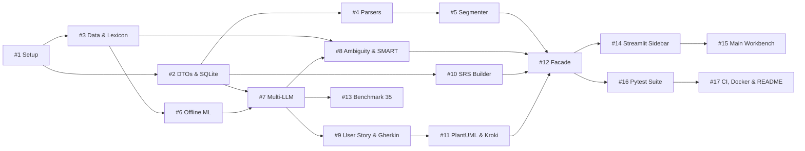

# Kế hoạch Triển khai Dự án — BA-Gen (ReqAssist-NLP)

Tài liệu này quy định quy trình làm việc Git, lộ trình 4 Sprints tương ứng **17 GitHub Issues**, kế hoạch kiểm thử định lượng và kịch bản trình diễn thực tế.

---

## 1. Quy trình Phát triển & Quản lý Git (Agile Scrum + GitFlow)

### 1.1 Chiến lược phân nhánh (Branching Strategy)
- **`main`**: Nhánh phát hành ổn định; chỉ nhận Pull Request đã vượt qua kiểm thử tự động từ `develop`.
- **`develop`**: Nhánh tích hợp các tính năng hoàn chỉnh sau mỗi Sprint.
- **Nhánh tính năng (`feat/issue-<so>-<ten-ngan>`):** Mỗi Issue được triển khai trên một nhánh riêng tách từ `develop` (hoặc `main` ở giai đoạn khởi tạo), ví dụ: `feat/issue-04-document-parser`, `feat/issue-07-multi-llm`.

### 1.2 Quy chuẩn Commit & Pull Request
- Tuân thủ **Conventional Commits**:
  - `feat:` thêm tính năng mới
  - `fix:` sửa lỗi
  - `docs:` cập nhật tài liệu
  - `test:` bổ sung/sửa kịch bản kiểm thử
  - `refactor:` tái cấu trúc mã không đổi hành vi
  - `chore:` cấu hình môi trường, CI/CD, dọn dẹp
- **Liên kết Issue:**
  - Khi đang làm dở dùng `Refs #<số_issue>` trong thông điệp commit (không tự đóng Issue).
  - Chỉ dùng `Closes #<số_issue>` trong mô tả Pull Request sau khi đã kiểm tra đạt đủ **Tiêu chí hoàn thành (DoD)** của Issue đó.

---

## 2. Lộ trình 4 Sprints & Bảng Ánh xạ 17 GitHub Issues

### 2.1 Tổng quan Milestones & Phụ thuộc

| Milestone | Thời gian Dự kiến | Số lượng Issues | Mục tiêu Chính của Sprint |
| :--- | :---: | :---: | :--- |
| **Sprint 1: Khởi tạo Dự án, Kiến trúc & Dữ liệu** | Tuần 1–2 | `#1` – `#3` | Hoàn chỉnh cấu trúc gói Python, lược đồ Pydantic, SQLite Cache và bộ 35 câu kiểm chuẩn + từ điển 120+ từ mơ hồ. |
| **Sprint 2: Đọc Tài liệu & Phân loại FR/NFR Lai ghép** | Tuần 3–4 | `#4` – `#7` | Hoàn thiện đọc tệp `.txt`/`.docx`, tách câu song ngữ, bộ phân loại `LinearSVC` ngoại tuyến và cổng Multi-LLM (Groq/OpenRouter/Gemini). |
| **Sprint 3: Bắt lỗi Mơ hồ, User Story & Xuất SRS/UML** | Tuần 5–6 | `#8` – `#13` | Hoàn thiện phát hiện mơ hồ/SMART, sinh User Story + Gherkin, xuất SRS `.docx`, vẽ PlantUML qua Kroki, `Facade` và Benchmark 35 câu. |
| **Sprint 4: Giao diện Streamlit, Kiểm thử & Đóng gói** | Tuần 7–8 | `#14` – `#17` | Hoàn thiện giao diện 4 thẻ làm việc, bộ test tự động đạt `>= 85%` coverage, GitHub Actions CI, Docker và `README.md`. |

---

### 2.2 Chi tiết Triển khai từng Sprint

#### Sprint 1: Khởi tạo Dự án, Kiến trúc & Dữ liệu
- **Issue #1** — [[Setup] Khởi tạo cấu trúc dự án, môi trường Python và cấu hình biến môi trường](https://github.com/nguyentrananhhoang13122005/BA-Gen/issues/1)
  - *Tệp tạo/sửa:* `requirements.txt`, `.env.example`, rà soát `.gitignore` và toàn bộ `__init__.py`.
  - *Lưu ý kỹ thuật:* Chốt phiên bản thư viện nhẹ tương thích Windows (`streamlit`, `pydantic>=2`, `python-docx`, `scikit-learn`, `openai`, `requests`, `python-dotenv`, `pytest`, `pytest-cov`, `flake8`).
  - *DoD:* `pip install -r requirements.txt` cài đặt thành công trên Python 3.10+, không gắn cứng khóa API.
- **Issue #2** — [[Core] Xây dựng lược đồ dữ liệu Pydantic (DTOs) và cơ sở dữ liệu SQLite có lưu đệm](https://github.com/nguyentrananhhoang13122005/BA-Gen/issues/2)
  - *Tệp tạo/sửa:* `src/core/models.py`, `src/core/database.py`.
  - *Lưu ý kỹ thuật:* Tạo đủ 4 bảng (`projects`, `requirements`, `user_stories`, `llm_cache`); khóa đệm dùng `SHA-256(req_text + provider + model)`.
  - *DoD:* Tự động sinh `reqassist.db` với `CREATE TABLE IF NOT EXISTS`, kiểm tra hợp lệ toàn bộ mô hình Pydantic.
- **Issue #3** — [[Data] Tạo bộ dữ liệu kiểm chuẩn 35 câu yêu cầu và từ điển từ mơ hồ song ngữ](https://github.com/nguyentrananhhoang13122005/BA-Gen/issues/3)
  - *Tệp tạo/sửa:* `data/benchmark_35_reqs.json`, `data/ambiguity_lexicon.json`, `data/sample_ecommerce_vi.docx`, `data/sample_ecommerce_vi.txt`, `src/utils/lexicon.py`.
  - *Lưu ý kỹ thuật:* Nạp 35 câu chuẩn (`20 FR`, `15 NFR`; `20 EN`, `15 VI`) từ dữ liệu báo cáo; từ điển >= 120 từ/cụm từ mơ hồ + danh sách từ khóa Actor và đơn vị đo; áp dụng **Singleton Pattern** trong `NLPLexiconManager`.
  - *DoD:* Tệp JSON đọc chuẩn UTF-8 không lỗi dấu; Singleton chỉ khởi tạo một thực thể duy nhất trong RAM.

#### Sprint 2: Đọc Tài liệu & Phân loại FR/NFR Lai ghép
- **Issue #4** — [[Backend] Xây dựng bộ đọc tài liệu đa định dạng (.txt, .docx, văn bản thô) theo Factory Method](https://github.com/nguyentrananhhoang13122005/BA-Gen/issues/4)
  - *Tệp tạo/sửa:* `src/parsers/factory.py` (kèm `IDocumentParser`, `RawTextParser`, `TxtDocumentParser`, `DocxDocumentParser`).
  - *Lưu ý kỹ thuật:* Chuẩn hóa `unicodedata.normalize("NFC", text)`; đọc cả đoạn văn và bảng biểu trong `.docx`; chặn định dạng nguy hiểm (`.exe`, `.bat`, `.docm`) và dung lượng `> 25 MB`.
  - *DoD:* Trích xuất đúng văn bản tiếng Việt có dấu từ `.txt`/`.docx` và báo lỗi tường minh với tệp không hợp lệ.
- **Issue #5** — [[NLP] Xây dựng bộ tiền xử lý, nhận diện ngôn ngữ và tách câu yêu cầu song ngữ](https://github.com/nguyentrananhhoang13122005/BA-Gen/issues/5)
  - *Tệp tạo/sửa:* `src/parsers/segmenter.py`.
  - *Lưu ý kỹ thuật:* Làm sạch ký hiệu đầu dòng (`•`, `-`, `*`, `1.`, `a)`), phát hiện ngôn ngữ (`vi`/`en`), bảo vệ số thập phân (`2.0`, `99.9%`) và từ viết tắt (`VD.`, `TP.`, `e.g.`, `i.e.`) khỏi bị cắt câu sai; lọc bỏ câu `< 4` từ.
  - *DoD:* Tách đúng danh sách câu yêu cầu nguyên tử trên cả văn bản tiếng Việt lẫn tiếng Anh.
- **Issue #6** — [[AI/ML] Xây dựng bộ phân loại FR/NFR ngoại tuyến (TF-IDF + LinearSVC) và Baseline từ khóa](https://github.com/nguyentrananhhoang13122005/BA-Gen/issues/6)
  - *Tệp tạo/sửa:* `src/classifiers/base.py`, `src/classifiers/keyword_baseline.py`, `src/classifiers/ml_classifier.py`.
  - *Lưu ý kỹ thuật:* Chuẩn hóa `decision_function` qua hàm sigmoid về thang `0–100%`; bổ sung bộ ánh xạ nhóm phụ NFR theo từ khóa khi chạy hoàn toàn ngoại tuyến.
  - *DoD:* Xử lý 50 câu ngoại tuyến trong `<= 1.5 giây`, trả về đầy đủ nhãn, nhóm phụ NFR và độ tin cậy.
- **Issue #7** — [[AI/LLM] Tích hợp cổng LLM đa nhà cung cấp (Groq, OpenRouter, Gemini) với Batch Prompting và Fallback](https://github.com/nguyentrananhhoang13122005/BA-Gen/issues/7)
  - *Tệp tạo/sửa:* `src/classifiers/llm_client.py`, `src/classifiers/llm_classifier.py`, `src/classifiers/hybrid_classifier.py`.
  - *Lưu ý kỹ thuật:* Dùng chung thư viện `openai` cho Groq, OpenRouter, Gemini và Ollama; gom `10–15` câu/lượt gọi với `temperature = 0.1`; kiểm tra `llm_cache` trước khi gọi mạng; thử lại tối đa 2 lần rồi chuyển mạch dự phòng về `OfflineMLClassifierStrategy`.
  - *DoD:* Đổi giữa Groq và OpenRouter bằng cấu hình; bộ 35 câu tốn tối đa 3 lượt gọi; tắt mạng tự động fallback không văng lỗi.

#### Sprint 3: Bắt lỗi Mơ hồ, User Story & Xuất SRS/UML
- **Issue #8** — [[NLP] Xây dựng bộ phát hiện từ mơ hồ, thiếu Actor, thiếu số liệu và gợi ý chuẩn SMART](https://github.com/nguyentrananhhoang13122005/BA-Gen/issues/8)
  - *Tệp tạo/sửa:* `src/analyzers/ambiguity_detector.py`.
  - *Lưu ý kỹ thuật:* Khớp cụm từ đa từ tiếng Việt (*"dễ sử dụng"*, *"an toàn tuyệt đối"*) theo ranh giới từ chuẩn Unicode; kiểm tra chủ ngữ Actor và biểu thức chính quy số liệu/đơn vị đo đối với câu NFR; sinh gợi ý viết lại SMART theo lô (hoặc mẫu ngoại tuyến).
  - *DoD:* Phát hiện đúng các câu mơ hồ mẫu và không báo nhầm NFR đã có chỉ số đo lường hợp lệ.
- **Issue #9** — [[AI/LLM] Xây dựng bộ sinh Agile User Stories và Tiêu chí Nghiệm thu Gherkin](https://github.com/nguyentrananhhoang13122005/BA-Gen/issues/9)
  - *Tệp tạo/sửa:* `src/generators/user_story_gen.py`.
  - *Lưu ý kỹ thuật:* Tôn trọng đúng ngôn ngữ tài liệu (mẫu Việt hoặc Anh); tự suy luận vai trò kỹ thuật cho NFR hạ tầng; bảo đảm >= 2 kịch bản `GIVEN / WHEN / THEN` (1 thành công, 1 lỗi/biên) và mã truy vết `req_id <-> story_id`.
  - *DoD:* 100% câu yêu cầu tạo thành công User Story đủ 3 thành phần và >= 2 Gherkin AC.
- **Issue #10** — [[Exporter] Xây dựng bộ xuất Tài liệu SRS Rút gọn (.docx và .md) theo Builder Pattern](https://github.com/nguyentrananhhoang13122005/BA-Gen/issues/10)
  - *Tệp tạo/sửa:* `src/exporters/srs_builder.py`.
  - *Lưu ý kỹ thuật:* Thiết kế phương thức chuỗi (`build_overview().build_actors()...export_docx()`); cấu hình phông chữ hỗ trợ đầy đủ tiếng Việt (`Calibri`/`Times New Roman`) và định dạng bảng biểu rõ ràng.
  - *DoD:* Xuất tệp `.docx` và `.md` trong `<= 2.0 giây`, mở chuẩn trên MS Word/LibreOffice/Google Docs.
- **Issue #11** — [[Exporter] Xây dựng bộ sinh mã PlantUML và kết xuất ảnh Sơ đồ Use Case](https://github.com/nguyentrananhhoang13122005/BA-Gen/issues/11)
  - *Tệp tạo/sửa:* `src/exporters/plantuml_exporter.py`.
  - *Lưu ý kỹ thuật:* Gom nhóm Actor duy nhất, thoát ký tự ngoặc kép trong tên Use Case; gọi `POST https://kroki.io/plantuml/png` (hoặc `/svg`) để lấy ảnh trực tiếp không cần Java/Graphviz; khi mất mạng vẫn trả về tệp `.puml` hợp lệ.
  - *DoD:* Sinh cú pháp `@startuml ... @enduml` hợp lệ 100%, hiển thị ảnh sắc nét tiếng Việt.
- **Issue #12** — [[Core] Xây dựng lớp điều phối trung tâm RequirementAnalysisFacade (Facade Pattern)](https://github.com/nguyentrananhhoang13122005/BA-Gen/issues/12)
  - *Tệp tạo/sửa:* `src/core/facade.py`.
  - *Lưu ý kỹ thuật:* Điều phối trọn vẹn 6 bước xử lý, lưu nhật ký thời gian từng giai đoạn và hỗ trợ các thao tác Human-in-the-Loop (áp dụng SMART, sửa nhãn `FR`/`NFR`, đồng bộ lại SRS & PlantUML).
  - *DoD:* Giao diện Streamlit chỉ giao tiếp qua `RequirementAnalysisFacade`.
- **Issue #13** — [[AI/Evaluation] Xây dựng module Đánh giá Kiểm chuẩn trên bộ 35 câu yêu cầu](https://github.com/nguyentrananhhoang13122005/BA-Gen/issues/13)
  - *Tệp tạo/sửa:* `src/classifiers/evaluate_benchmark.py`.
  - *Lưu ý kỹ thuật:* Đánh giá `Offline LinearSVC` bằng **Stratified K-Fold** để tránh rò rỉ dữ liệu tập huấn luyện; so sánh trực tiếp 3 mô hình trên 35 câu và xuất JSON/CSV.
  - *DoD:* Mô hình lai ghép đạt `Accuracy >= 90.0%` và `Macro F1 >= 0.88`.

#### Sprint 4: Giao diện Streamlit, Kiểm thử & Đóng gói
- **Issue #14** — [[UI] Xây dựng giao diện chính Streamlit và thanh công cụ cấu hình Sidebar](https://github.com/nguyentrananhhoang13122005/BA-Gen/issues/14)
  - *Tệp tạo/sửa:* `app.py`, `src/ui/sidebar.py` (và tệp CSS/style nếu cần).
  - *Lưu ý kỹ thuật:* Chọn Provider (`Groq`, `OpenRouter`, `Gemini`, `Offline ML`), nhập API Key ẩn (`type="password"`) tự nạp từ `.env`, thanh trượt ngưỡng tin cậy (`0.50`–`0.95`), nút 1-click nạp tài liệu mẫu và tải SRS.
  - *DoD:* Hiển thị chuẩn từ `1366×768` trở lên, không lộ API Key.
- **Issue #15** — [[UI] Xây dựng 4 thẻ chức năng chính trên Main Workbench (Yêu cầu, User Story, SRS/UML, Benchmark)](https://github.com/nguyentrananhhoang13122005/BA-Gen/issues/15)
  - *Tệp tạo/sửa:* `src/ui/workbench.py` (hoặc chia theo 4 tab).
  - *Lưu ý kỹ thuật:* Tô đỏ từ mơ hồ ngay trong câu (HTML escape trước khi gắn thẻ highlight để tránh XSS), nút 1-click áp dụng SMART, sửa trực tiếp User Story và đồng bộ tức thời sang Tab 3.
  - *DoD:* Mọi chỉnh sửa cập nhật ngay sang KPI cards, SRS tải về và sơ đồ PlantUML.
- **Issue #16** — [[QA] Xây dựng bộ kiểm thử tự động Unit Test và Integration Test (độ bao phủ >= 85%)](https://github.com/nguyentrananhhoang13122005/BA-Gen/issues/16)
  - *Tệp tạo/sửa:* `tests/test_parsers.py`, `tests/test_classifiers.py`, `tests/test_ambiguity.py`, `tests/test_generators_exporters.py`, `tests/test_facade_integration.py`.
  - *Lưu ý kỹ thuật:* Dùng `pytest-mock` giả lập lỗi `HTTP 429` và `Timeout` để kiểm chứng Fallback; dùng SQLite `:memory:` cho Integration Test.
  - *DoD:* `100%` ca test Pass, `pytest --cov=src >= 85%`, `flake8` 0 lỗi.
- **Issue #17** — [[DevOps] Cấu hình GitHub Actions CI, đóng gói Docker và hoàn thiện README.md](https://github.com/nguyentrananhhoang13122005/BA-Gen/issues/17)
  - *Tệp tạo/sửa:* `.github/workflows/ci.yml`, `Dockerfile`, `docker-compose.yml`, cập nhật `README.md`.
  - *Lưu ý kỹ thuật:* Đưa `flake8` + `pytest --cov=src` vào workflow CI; mở cổng `8501` trong Docker.
  - *DoD:* GitHub Actions xanh; `docker compose up` truy cập được `http://localhost:8501`.

---

## 3. Kế hoạch Kiểm thử & Đánh giá Kiểm chuẩn

### 3.1 Ma trận 4 Cấp độ Kiểm thử

| Cấp độ | Phạm vi | Công cụ | Tiêu chí Nghiệm thu |
| :--- | :--- | :--- | :--- |
| **1. Unit Test** | Parsers, Segmenter, AmbiguityDetector, UserStoryGen, SRSBuilder, PlantUML | `pytest`, `pytest-cov` | 100% ca kiểm thử đạt; độ bao phủ `>= 85%`. |
| **2. Integration Test** | Luồng `RequirementAnalysisFacade`, SQLite Cache, Fallback khi API lỗi | `pytest-mock`, SQLite `:memory:` | Tự chuyển về Offline ML trong `<= 2.0 giây`; Cache hoạt động đúng. |
| **3. System / UI Test** | Tương tác 4 thẻ Streamlit, tải tệp `.docx`, tải về SRS & ảnh sơ đồ | Kiểm thử kịch bản thủ công | Luồng chính hoàn tất trong tối đa `3` cú nhấp chuột; không lỗi UTF-8. |
| **4. Benchmark AI/NLP** | So sánh Baseline Từ khóa, Offline LinearSVC (K-Fold) và Hybrid ML+LLM | `scikit-learn.metrics` | `Accuracy >= 90.0%`, `Macro F1 >= 0.88` trên bộ 35 câu. |

---

## 4. Kịch bản Trình diễn Thực tế (Live Demo Checklist)

1. **Chuẩn bị trước giờ trình bày:**
   - Khởi tạo môi trường ảo `.venv`, cài đặt `requirements.txt` và cấu hình sẵn khóa **Groq** (khuyến nghị vì tốc độ `< 1 giây`) hoặc **OpenRouter** trong tệp `.env`.
   - Khởi chạy ứng dụng: `streamlit run app.py`.
2. **Luồng Demo 1 — Luồng chuẩn 3 cú nhấp chuột (Chế độ Hybrid LLM):**
   - Nhấn **"Nạp Tài liệu Mẫu"** (hoặc tải tệp `.docx` song ngữ).
   - Nhấn **"Phân tích Yêu cầu"** -> cho thấy kết quả tách câu, phân loại `FR`/`NFR`, tô đỏ từ mơ hồ (`"nhanh"`, `"thân thiện"`).
   - Bấm **"Áp dụng câu gợi ý SMART"**, kiểm tra thẻ User Story (`GIVEN/WHEN/THEN`), xem ảnh Use Case PlantUML và tải xuống tệp SRS `.docx` mở ngay trên Word.
3. **Luồng Demo 2 — Kiểm chứng Tính Chịu lỗi (Offline Fallback):**
   - Chuyển sang **Offline ML** hoặc nhập sai API Key để mô phỏng sự cố mạng -> bấm chạy lại để chứng minh hệ thống tự động chuyển về `TF-IDF + LinearSVC` và vẫn xuất đầy đủ SRS/PlantUML mà không bị lỗi ứng dụng.
4. **Luồng Demo 3 — Báo cáo Kiểm chuẩn Định lượng:**
   - Mở **Thẻ 4 (Benchmark)** -> chạy trực tiếp trên 35 câu yêu cầu chuẩn để trình bày Accuracy, Macro F1-Score và Ma trận Nhầm lẫn 2×2.
